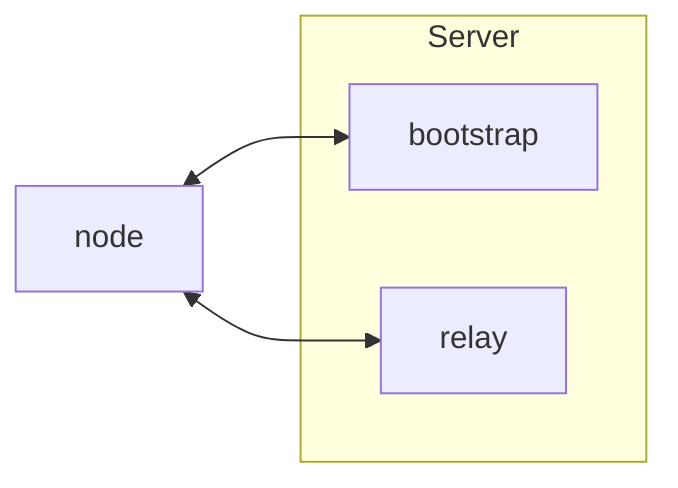

# locap2p

Trust-based locality-aware framework for distributed applications.

## Architecture



## Dependencies

If using NixOS, simply run:
```sh
nix develop
```

Otherwise, read the ```flake.nix``` file to install required dependencies.

## Running bootstrap and relay

The bootstrap and relay services can either be ran locally on a machine, or remotely on a virtual private server (VPS).

Both the bootstrap and relay services have been dockerised for deployment. Therefore, they can be executed either by Cargo or Docker.

Each service prints the endpoint to put into the application configuration.

### Configuration

The services need configuration files set-up. Examples can be found:
```
config/services/bootstrap.example.toml
config/services/relay.example.toml
```

Use these examples to populate:
```
config/services/bootstrap.toml
config/services/relay.toml
```

### Cargo
```sh
cargo run -p locap2p-bootstrap -- --config config/services/bootstrap.toml
cargo run -p locap2p-relay -- --config config/services/relay.toml
```

### Docker

To deploy locally:

```sh
./deploy/scripts/local-up.sh
./deploy/scripts/local-down.sh
```

To deploy to a remote VPS:
```sh
./deploy/scripts/remote-up.sh
./deploy/scripts/remote-down.sh
```

To monitor the logs:
```sh
docker logs -f locap2p-bootstrap-1
docker logs -f locap2p-relay-1
```

#### Virtual Private Servers

This project uses DigitalOcean Droplets. But this is just an option.

1. Create a DigitalOcean account and add billing.
2. Create a Personal Access Token with read/write access.
3. Add your SSH public key under **Settings -> Security -> SSH Keys**.
4. Authenticate `doctl`:

```sh
doctl auth init
doctl compute ssh-key list
```

Need to populate the `deploy/.env` file. Use the `deploy/.env.example` file as reference. Put the SSH key fingerprint in `deploy/.env` as `DO_SSH_KEY`.

## Running demo application

```sh
cargo build -p locap2p-host

./apps/demo/gradlew -p apps/demo :app:run --args="--host-bin $PWD/target/debug/locap2p-host --config $PWD/config/application.remote.json"
```

## Useful resources

### JIRA

https://jameskeywood.atlassian.net/jira/software/projects/LOC/summary

### NixOS
- Rust Rover: https://nixos.wiki/wiki/Rust_Rover
- Rust overlay: https://github.com/oxalica/rust-overlay

### Build tools
- Cargo: https://docs.rs/cargo/latest/cargo/
  - Workspaces: https://doc.rust-lang.org/cargo/reference/workspaces.html
- Gradle: https://docs.gradle.org/
- Checkstyle plugin: https://checkstyle.org/getting-started.html

### Deployment tools
- Docker: https://docs.docker.com/
  - Build: https://docs.docker.com/build/
  - Context (dockerignore): https://docs.docker.com/build/concepts/context/
  - Compose: https://docs.docker.com/compose/
- GitHub packaging: https://docs.github.com/en/packages/working-with-a-github-packages-registry/working-with-the-container-registry
- DigitalOcean droplets: https://cloud.digitalocean.com/droplets

### Programming
- Rust book: https://doc.rust-lang.org/book/

### Networking
- libp2p docs: https://libp2p.io/docs/
	- AutoNAT: https://libp2p.io/docs/autonat/
	- Circuit Relay: https://libp2p.io/docs/circuit-relay/
	- Hole Punching: https://libp2p.io/docs/hole-punching/
	- DCUtR: https://libp2p.io/docs/dcutr/
- Rust libp2p: https://github.com/libp2p/rust-libp2p

### IPC
- Overview: https://en.wikipedia.org/wiki/Inter-process_communication
- NDJSON: https://en.wikipedia.org/wiki/JSON_streaming
- Unix Domain Sockets: https://kernel-internals.org/ipc/unix-sockets/
